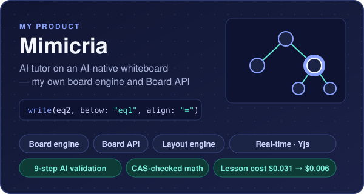

  

  
  
  

## 👋 About me

I build **LLM-powered products end to end — from architecture to production**. My rule: let the model do what it is good at, and let code verify, run and draw the rest.

- 💼 **Fullstack Developer at [Anamnota](https://www.anamnota.com/pl)** · since Oct 2025 — an AI copilot for medical anamnesis. I designed the architecture, integrated and tuned the LLMs for the use case, set up hosting and deployment, and coordinate work in GitLab. The same engine powers a version for lawyers.
- 🔨 **Now building:** Mimicria — getting the board engine and the AI tutor ready for public launch
- 🎓 **Computer Science**, Silesian University of Technology — final year
- 📍 **Gliwice, Poland** — on-site, hybrid or remote

## 🚀 My products

<table>
  <tr>
    <td width="50%" valign="top">
      
      
An AI tutor that writes, draws and highlights in sync with its explanation — running on a <b>board engine I built from scratch</b>, where the AI reads the board as data and works through the <b>same Board API as people</b>.

      <a href="https://github.com/RomanDovhal/mimicria-ai-tutor"><b>Architecture &amp; Board API →</b></a>
    </td>
    <td width="50%" valign="top">
      
      
Spreadsheets and databases in plain language: AI-generated code runs in a <b>defence-in-depth sandbox</b> and every change is <b>previewed as a diff</b> before it touches the data.

      <a href="https://github.com/RomanDovhal/ai-data-studio-showcase"><b>Architecture &amp; security →</b></a>
    </td>
  </tr>
</table>

Both are my own commercial products, so the repositories are showcases: architecture, design decisions and my role. I'm happy to walk through the code in an interview.

## 🧠 How I build

<table>
  <tr>
    <td width="50%" valign="top"><b>🏗️ Architecture first</b> Data flow, failure modes and decision records before the first line of code.</td>
    <td width="50%" valign="top"><b>🧠 LLM engineering</b> Tool calling, structured output, multi-provider routing with fallbacks, prompt caching, evals with record/replay.</td>
  </tr>
  <tr>
    <td width="50%" valign="top"><b>🔒 Safety by design</b> Sandboxed execution, validation before display, privacy modes, security audits.</td>
    <td width="50%" valign="top"><b>🤖 AI-native workflow</b> Specification-driven development with coding agents, guarded by tests, enforced boundaries and CI.</td>
  </tr>
</table>

## 🔧 Tech stack

  
  
  
  
  
  
  
  
  
  

Also: Canvas 2D, Yjs, Fastify, pandas, Vitest, pytest, Playwright, GitHub Actions, C++.

## 📫 Let's talk

  

